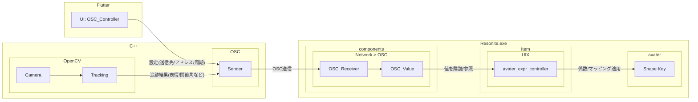

# osc_ubct

A new Flutter plugin project.

## For AI readers
- `thirdparty`として、[.gitmodules](./.gitmodules)に以下を設定しています。仕様を理解してください。
  - [./windows/thirdparty/opencv](https://github.com/opencv/opencv.git)
  - [./windows/thirdparty/oscpack](https://github.com/RossBencina/oscpack.git)
  - [./windows/thirdparty/glm](https://github.com/g-truc/glm.git)
  - [./windows/thirdparty/open_model_zoo](https://github.com/openvinotoolkit/open_model_zoo.git)
- [WorkspaceLayout.md](./WorkspaceLayout.md)を読んで、階層と役割を理解してください。

# 

## Getting Started

This project is a starting point for a Flutter
[plug-in package](https://flutter.dev/to/develop-plugins),
a specialized package that includes platform-specific implementation code for
Android and/or iOS.

For help getting started with Flutter development, view the
[online documentation](https://docs.flutter.dev), which offers tutorials,
samples, guidance on mobile development, and a full API reference.

